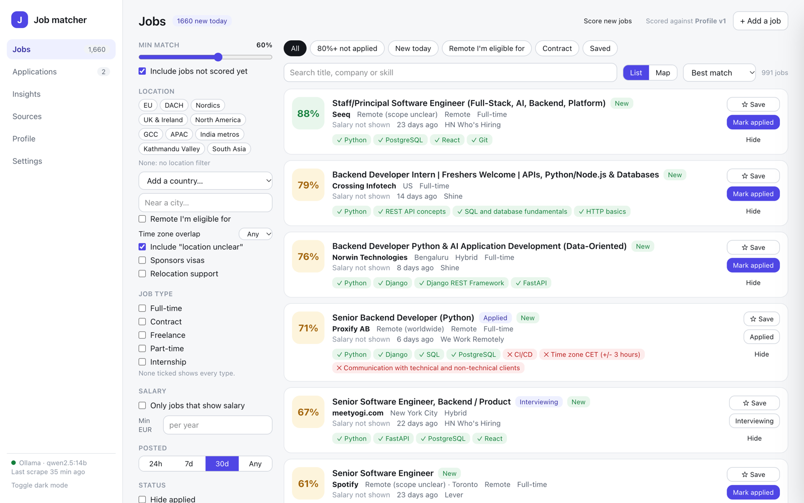
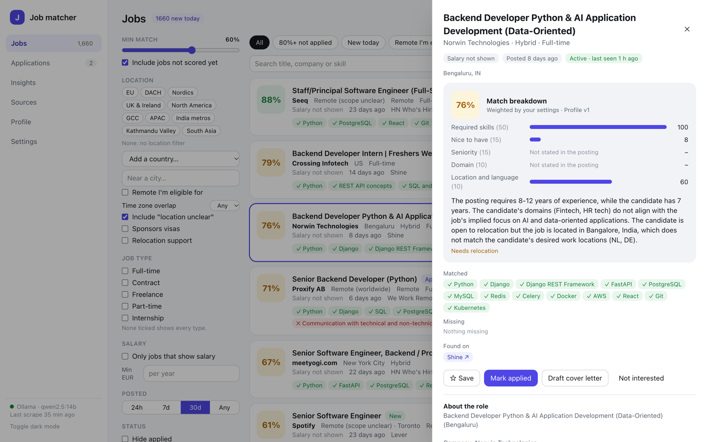
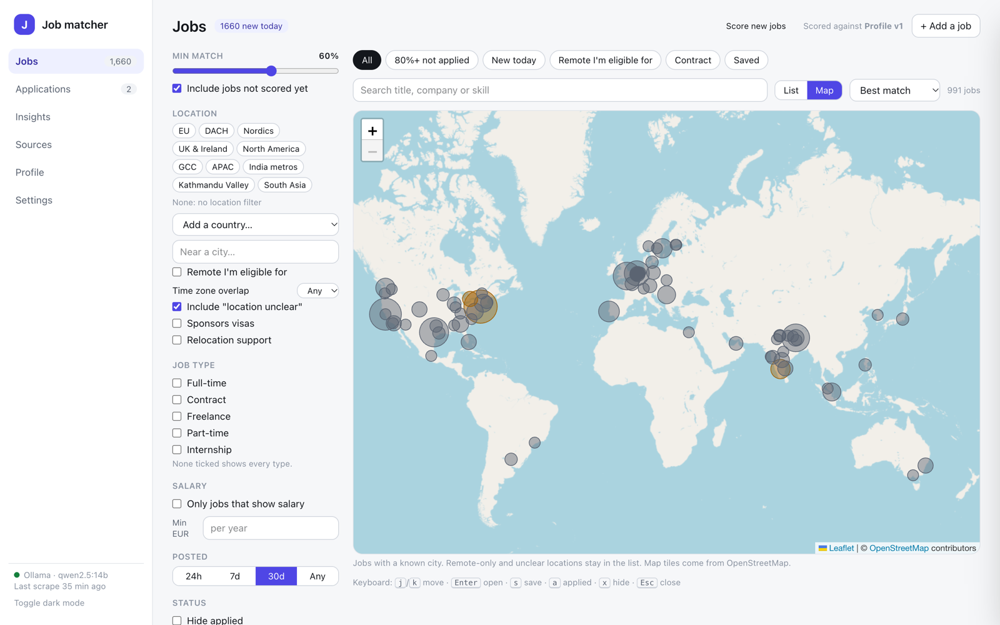
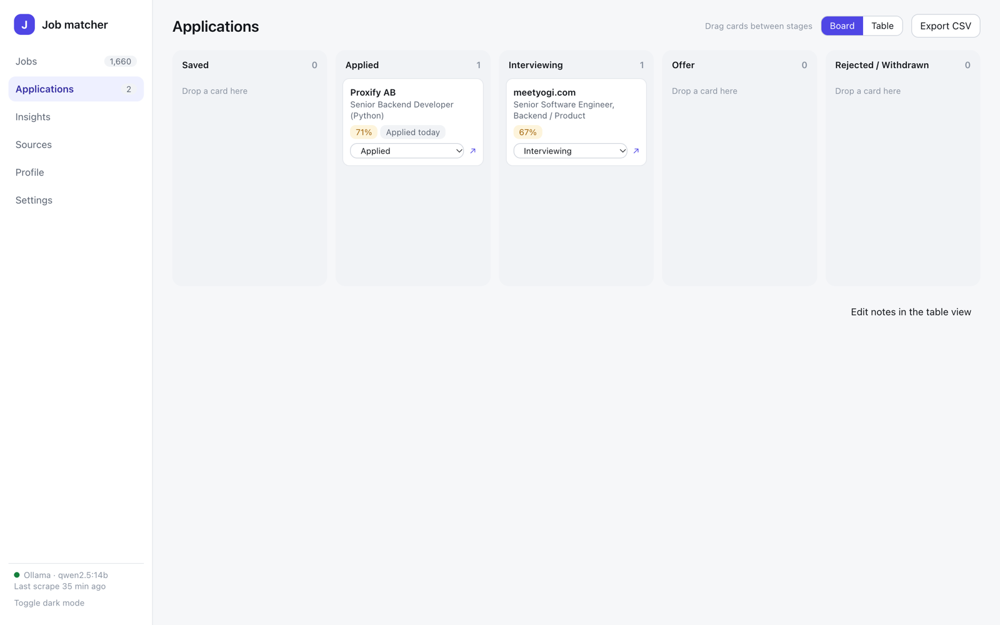
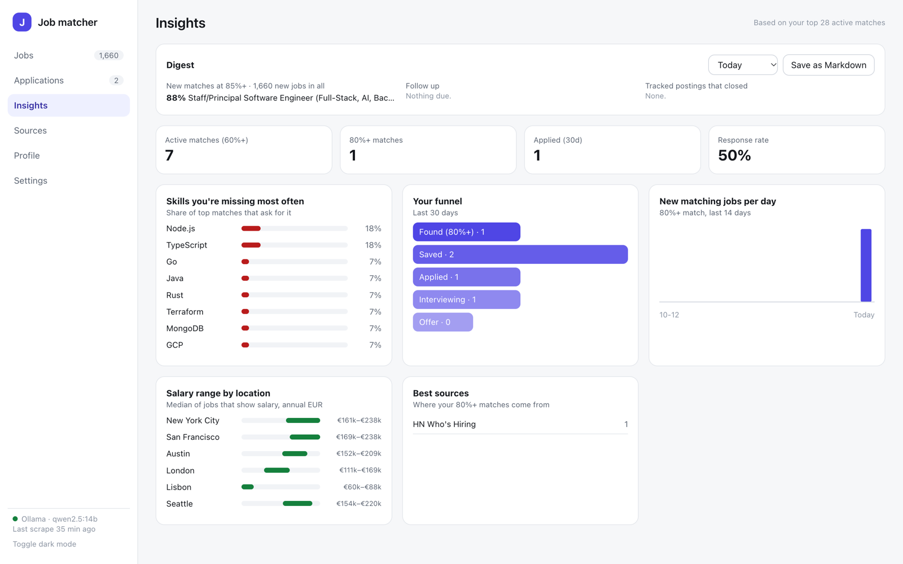
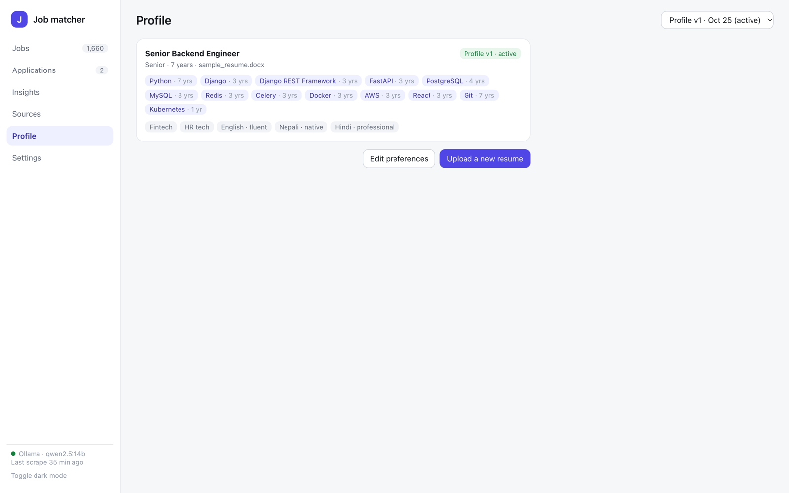
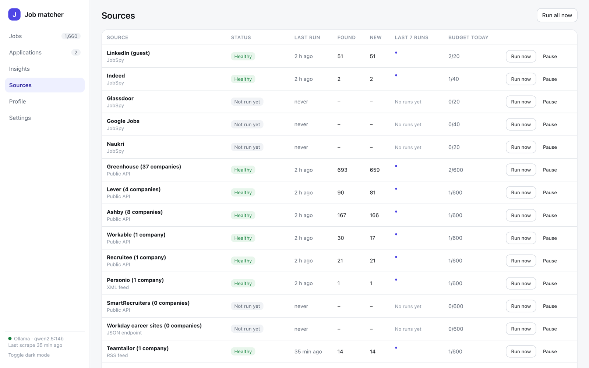
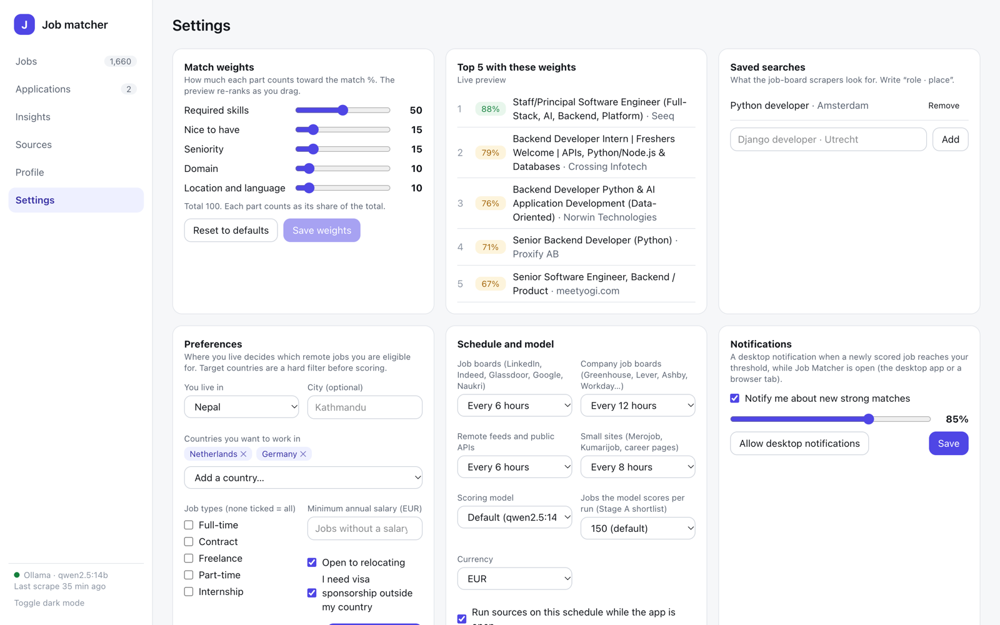

# Job Matcher

A local-first job search assistant: it reads your resume, gathers active postings from
free sources worldwide, and ranks them by how well they fit you, scored by a language
model running on your own machine.



## Screens

| | |
|---|---|
|  |  |
| **Job detail.** The weighted breakdown, the model's explanation, matched and missing skills, every source, and a cover-letter draft. | **Map.** Matching jobs by city on OpenStreetMap. A "near a city" radius filter and a time zone overlap filter work in both views. |
|  |  |
| **Applications.** A kanban board with drag and drop, follow-up reminders, a table view with notes, and CSV export. | **Insights.** A daily digest, your most common missing skills, your funnel, matches per day, salary by location and the best sources. |
|  |  |
| **Profile.** Built from your resume, GitHub, portfolio and LinkedIn export, with where each skill came from. Every save is a new version. | **Sources.** Health, 7-run history and daily budget per source, with run now and pause, plus the company board list. |



**Settings.** Match weights with a live re-rank preview, saved searches, preferences,
schedules, model, currency, notifications and optional free API keys.

*Screenshots come from a demo database with a fictional profile.*

## Features

- **Profile from your own files.** Upload a PDF or DOCX resume and optionally add GitHub,
  a portfolio page and LinkedIn's official data export. A local model extracts skills,
  seniority, domains and languages. You review every field, see where each skill came
  from, and save numbered versions.
- **Free sources only.**
  - **Company job boards:** Greenhouse, Lever, Ashby, Workable, Recruitee, Personio,
    SmartRecruiters, Teamtailor and Workday, with Common Crawl discovery.
  - **Public feeds:** Remotive, RemoteOK, Arbeitnow, Himalayas, Jobicy, We Work Remotely,
    Hacker News "Who is hiring" and JobTech.
  - **Logged-out job boards** via [JobSpy](https://github.com/speedyapply/JobSpy):
    LinkedIn guest pages, Indeed, Glassdoor, Google Jobs and Naukri.
  - **Nepal:** Merojob, Kumarijob, JobsNepal and Jobejee.
  - **India:** Shine, Internshala and Freshersworld.
  - **Optional free-key APIs:** Adzuna, Jooble, Reed, USAJobs and France Travail.
- **Normalisation.** Salaries are converted to annual amounts in your currency (including
  LPA, lakh and NPR). Locations are resolved offline with GeoNames, covering remote
  eligibility, visa sponsorship, relocation, time zones and required languages.
  Duplicates across boards, cities and reworded titles are merged without deleting
  anything.
- **Honest match scores.** Stage A uses embeddings and your hard filters. Stage B is an
  LLM assessment validated against a schema, with the percentage computed in code from
  your weights. A job whose model answer doesn't validate, or that has no description to
  compare, shows as unscored rather than getting a guessed number.
- **Only active jobs.** Postings that disappear from their source, pass their deadline or
  stop answering are expired with a reason, never deleted.
- **Find jobs your way.** Filters, saved views, search, keyboard shortcuts
  (`j`/`k`/`s`/`a`/`x`), a map, "near a city", time zone overlap, and adding a job from a
  link or pasted text.
- **Stay on top of it.** Native or browser notifications for new strong matches, and a
  daily digest you can save as Markdown.
- **Polite by design.** robots.txt is respected, with random delays, caching and a daily
  request budget per source. A source that meets a block or CAPTCHA is paused, not
  forced.

## Privacy and security

Everything runs on your computer. The LLM and the embedding model run in
[Ollama](https://ollama.com), and the database is a local SQLite file. Your resume and
profile are never sent to a cloud model or any third-party service.

The app makes outgoing requests only to:
- public job sources;
- reference data (GeoNames, ECB exchange rates);
- OpenStreetMap map tiles;
- the public GitHub API and your portfolio page, when you add those links.

The API and UI listen on 127.0.0.1 only. The API also refuses DNS-rebinding and
cross-site requests, so web pages open in your browser can't act on your data.

## Architecture

```
Sources (ATS APIs, feeds, JobSpy, sitemaps, free-key APIs)
      │  fetch(ctx) -> FetchResult(RawJob…, complete scopes)
      ▼
Normalise (salary + FX, GeoNames locations and time zones, remote/visa/type/language)
      ▼
Deduplicate (company + title, then embedding similarity) → jobs, job_sources, job_locations
      ▼
Lifecycle (missed listings, deadlines, URL checks, stale)
      ▼
Matching  A: bge-m3 embeddings (sqlite-vec) + hard filters → shortlist
          B: local LLM → validated JSON → weighted % in code
      ▼
FastAPI ──► Next.js UI: Jobs · Applications · Insights · Sources · Profile · Settings
                └──► Tauri desktop shell (optional)
```

Background work (parsing, source runs, scoring) runs as in-process tasks whose progress
the UI polls. An APScheduler tick runs each source group on its schedule.

## Tech stack

| Layer | Choice |
|---|---|
| Backend | Python 3.12, FastAPI, Pydantic |
| Storage | SQLite with `sqlite-vec` |
| LLM and embeddings | Ollama: `qwen2.5:14b` (or `llama3.1:8b`), `bge-m3` |
| Ingestion | httpx, python-jobspy, selectolax, PyMuPDF, python-docx, trafilatura |
| Reference data | GeoNames `cities15000`, ECB daily rates |
| Frontend | Next.js, TypeScript, Tailwind CSS, shadcn/ui, TanStack Query, Leaflet |
| Desktop | Tauri 2 (Rust) |

## Getting started

Prerequisites: macOS or Linux, Python 3.12 (via pyenv), Node.js 20+, and Ollama
installed natively. On a Mac, run Ollama outside Docker so it can use the GPU.

```bash
brew install ollama && brew services start ollama
ollama pull qwen2.5:14b
ollama pull bge-m3
```

Install dependencies and start the API (port 8000) and UI (port 3000):

```bash
make setup
make dev
```

Then open http://localhost:3000:

1. **Profile**: upload your resume, review the result and save it. A full resume takes
   the 14B model one to two minutes.
2. **Settings**: add a saved search such as "Python developer · Kathmandu" and set
   where you live and want to work.
3. **Sources**: click **Run all now**. New jobs are scored in the background and appear
   ranked on **Jobs**.

On first start the app downloads GeoNames (about 3 MB) and the ECB rates into `data/`,
which is git-ignored.

## Desktop app

A [Tauri](https://tauri.app) shell wraps the same UI in a native macOS window with native
notifications. It starts the API and the built UI itself (or reuses a running
`make dev`) and stops them when you quit. It needs Rust ([rustup.rs](https://rustup.rs)).

```bash
make desktop       # build the UI and bundle desktop/src-tauri/target/release/bundle/macos/Job Matcher.app
make desktop-dev   # open the desktop window without bundling
```

The app runs from this repository (set `JM_HOME` to point it elsewhere); server logs go to
`data/logs/`.

## Development

```bash
make check   # ruff, black, pytest, eslint, tsc
make smoke   # round-trip through the real local Ollama models
make fmt     # ruff --fix and black
```

The test suite uses a fake Ollama and a small GeoNames fixture, so it needs no network
and no models.

## Project status

| Phase | Scope | Status |
|---|---|---|
| 0 | Setup: FastAPI, Next.js shell, native Ollama | Done |
| 1 | Profile builder and setup wizard | Built; awaiting sign-off with a real resume |
| 2 | JobSpy source and basic normalisation | Built |
| 3 | ATS boards, feeds, Nepal and India boards, free-key APIs, discovery | Built; more sources planned |
| 4 | Salary, locations, remote eligibility, visa, dedup | Built |
| 5 | Matching engine | Built; awaiting a hand-judged ranking check |
| 6 | Lifecycle and expiry | Built |
| 7 | Product UI, map, radius and time zone filters | Built; awaiting a week of daily use |
| 8 | Scheduling and monitoring | Built; awaiting a 3-day unattended run |
| 9 | Insights, digest, notifications, cover letters, desktop app | Built; feedback-tuned weights and deeper gap analysis planned |

[docs/PLAN.md](docs/PLAN.md) has the full plan, what isn't built yet and the decision log.
The UI reference mockup is [docs/mockups/job-matcher-mockup.html](docs/mockups/job-matcher-mockup.html).
