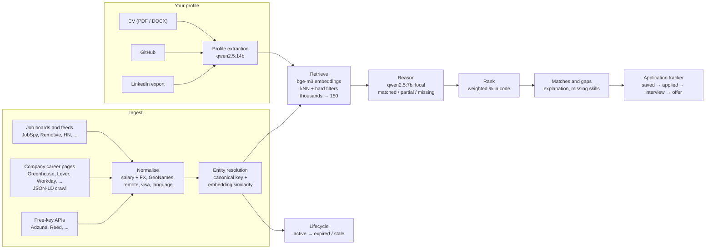
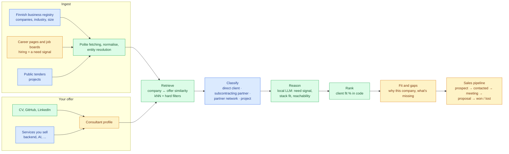

# Architecture

Job Matcher is a pipeline: **Ingest → Retrieve → Reason → Rank → Track**. This page shows
what it does today and how the same pipeline becomes a second mode, the Client Matcher,
which is proposed and not built yet. Scope and decisions live in [PLAN.md](PLAN.md).

## The approach

One rule shapes the design: **LLM for perception, code for judgement.** The local model
reads messy text and classifies it. Code makes every decision that produces a number.

- **Ingest.** Turn many messy sources into one clean, deduplicated set of records.
- **Retrieve.** Cheap vector search narrows thousands of records to a shortlist.
- **Reason.** The local LLM reads each shortlisted record and classifies the fit, as
  schema-validated JSON.
- **Rank.** Deterministic code turns those classes into a percentage with your weights.
- **Track.** A small state machine follows what you did with each match.

Retrieval is cheap and the LLM is expensive, so the LLM only runs on the shortlist. That
is what lets the whole thing run on a laptop.

## 1. Job Matcher today

**Ingest.** 35 source plugins: job boards and feeds, company career pages on nine ATS
platforms, a schema.org JSON-LD crawler for other career sites, and free-key APIs. New
companies are found through Common Crawl and from links inside postings. Salaries become
annual amounts in your currency, locations resolve offline with GeoNames, and remote
scope, visa and language requirements are extracted. One posting on five boards becomes
one job with five sources.

**Your profile.** Built from your CV, your public GitHub, your portfolio and your
LinkedIn data export. LinkedIn is never scraped. You review the result before it is used,
and every save is a new version.

**Retrieve.** Jobs and your profile are embedded with `bge-m3`. A k-nearest-neighbour
search in `sqlite-vec` takes the closest jobs, hard filters remove the ones you can't
take (location eligibility, job type, minimum salary, inactive), and the best 150 go on.

**Reason.** For each shortlisted job, `qwen2.5:7b` classifies the required and
nice-to-have skills as matched, partial or missing, and rates seniority, domain and
location fit. The output must match a schema. An answer that doesn't validate is retried
once, then the job shows as "unscored".

**Rank.** Code maps those classes to numbers and takes a weighted average with your
weights. A part the posting gives no basis for drops out instead of counting as zero.
Changing a weight recomputes every percentage at once, with no LLM call.

**Track and lifecycle.** You save and move jobs across a board, and every status change is
kept. A job that disappears from its source twice, passes its deadline or stops answering
is marked expired with a reason. Nothing is deleted.

## The local AI

Everything runs on your own machine through Ollama. Your CV and profile never go to a
cloud model or to any API.

| Model | Job | Why this one |
|---|---|---|
| `qwen2.5:14b` | Reads your CV, pasted postings, cover-letter drafts | Runs rarely, so it can be the careful one |
| `qwen2.5:7b` | Scores every shortlisted job | Runs thousands of times, so it has to be fast |
| `bge-m3` | Embeddings for retrieval and dedup | Multilingual, so Dutch, German, Hindi and Nepali postings compare fairly |

Speed on a normal laptop came from three changes: a smaller model for scoring, capped
answers (on a laptop, answer length is most of the time), and three jobs scored in
parallel. Scoring went from about 35 seconds a job to about 5. The measurements are in the
PLAN.md decision log (2026-10-26).

Scoring and CV reading need no internet once the models are pulled. Only fetching new
jobs does.

## 2. Client Matcher (proposed)

Same pipeline, different question. Instead of "which job fits me?", it asks "which
Finnish company needs what I offer?". The colours show what is reused as it is, what is
extended, and what is new.

**Legend:** green is reused as it is, amber is extended, blue is new.

| Stage | Job Matcher | Client Matcher | Reuse |
|---|---|---|---|
| Ingest | Job postings from 35 sources | Finnish companies, their hiring and public tenders | Polite fetching, budgets, normalisation and entity resolution reused; company sources new |
| Profile | You as a candidate | You as a consultant, plus the services you sell | Extended |
| Retrieve | Job ↔ profile similarity | Company ↔ offer similarity | Reused |
| Classify | Not needed | Direct client, subcontracting partner, partner network or project | New |
| Reason | Skill match per job | Need signal, stack fit, language and location reach | Same pattern: the LLM classifies, output is schema-validated |
| Rank | Match % | Client fit % | Same weighted code, new weights |
| Track | Application board | Sales pipeline | Same state machine and event history, new stages |

**The four company types.** A direct client buys from you, for example a SaaS company
hiring backend or AI engineers. A subcontracting partner is a consultancy that places you
with its own clients. A partner network brokers consultants to many buyers. A project is
one concrete opportunity, such as a tender or a fixed-term contract posting.

**Data model, roughly.** `companies` gains a business ID, industry and type. New tables
hold company signals (a hiring post, a tender, a funding round), client scores per
consultant profile, and deals with their events, following the same pattern as
`applications` and `application_events`.

**The same rules hold.** Free sources only, the local LLM only, polite fetching, nothing
hard deleted, and an "unscored" result rather than a guessed number. The app never sends
emails or messages; contacting a company is always done by you.

### Open questions

- Which free Finnish sources to use. Candidates to check: the PRH/YTJ open data API for
  the business registry, Hilma for Finnish public tenders, TED for EU tenders, and Finnish
  companies' career pages (many use Teamtailor, which is already supported).
- How to tell a consultancy from a product company reliably: industry codes, website text,
  or both.
- The client fit weights, and which signals count as a real need.
